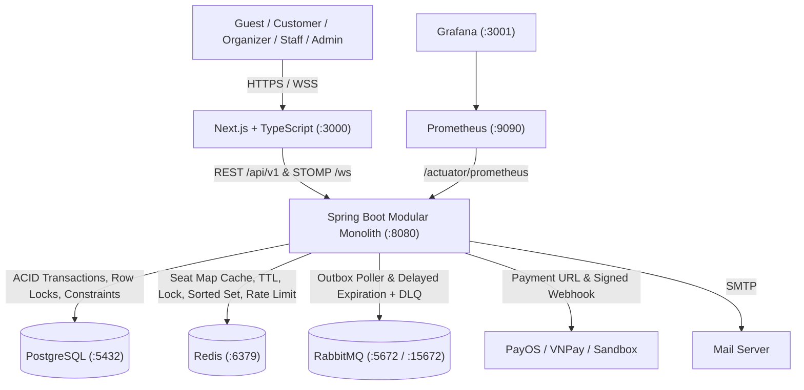

# Architecture Documentation

## High-Level System Architecture

## Modular Monolith Layers

- **Controller**: HTTP/DTO validation, delegates immediately to Application Service (zero business logic, zero direct Entity responses).
- **Application Service**: Orchestrates `@Transactional` boundaries, locks, idempotency, outbox persistence, and post-commit events.
- **Domain / Entity / Enums**: Encapsulates state machines (`EventStatus`, `ReservationStatus`, `OrderStatus`, `PaymentStatus`, `TicketStatus`) and optimistic locking (`@Version`).
- **Repository**: Spring Data JPA (`PESSIMISTIC_WRITE`, Criteria `Specification`, atomic `UPDATE`, native `ON CONFLICT DO NOTHING`).
