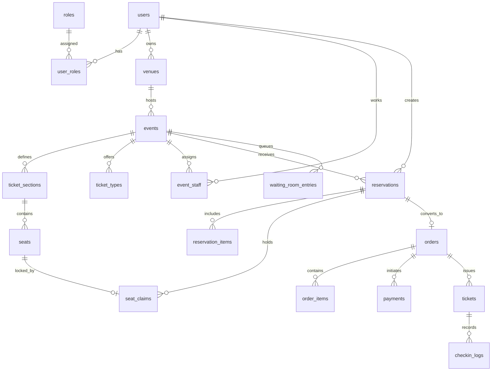

# Entity Relationship Diagram (ERD)

## Key Design Decisions
- **`seat_claims.seat_id` as PRIMARY KEY**: Enforces at the database level that at most one active hold exists per seat regardless of application concurrency.
- **`orders.reservation_id` UNIQUE**: Prevents creating multiple orders for the same reservation.
- **`webhook_events` `UNIQUE(provider, provider_event_id)` + `INSERT ... ON CONFLICT DO NOTHING`**: Guarantees atomic webhook deduplication under concurrent retries.
- **`tickets` Partial Unique Index (`uq_tickets_active_seat`)**: Guarantees one seat cannot have multiple `VALID`/`CHECKED_IN` tickets while allowing re-issuance if an order is refunded.
- **Transactional `outbox_events`**: Ensures business state changes and messaging events commit atomically.
